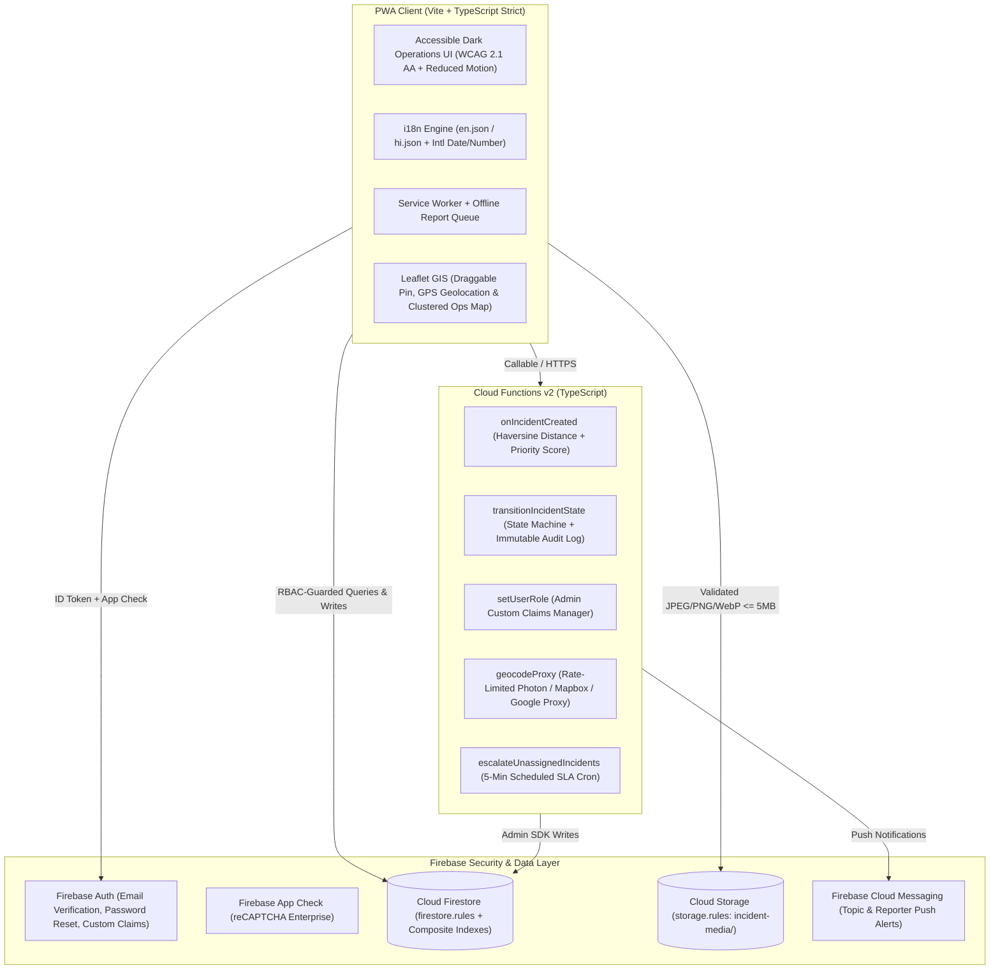

# 🚨 City Emergency Response System (CERS) v2.0

A production-grade, real-time emergency reporting, automated triage, and multi-agency Computer-Aided Dispatch (CAD) platform built with **Vite**, **TypeScript (Strict Mode)**, **Firebase (Authentication, Cloud Firestore, Cloud Storage, Cloud Functions v2, Cloud Messaging, App Check)**, and **Leaflet.js**.

---

## 🏗️ System Architecture



---

## 🗄️ Data Model & Composite Indexes

### 1. `users/{uid}`
| Field | Type | Description |
|---|---|---|
| `uid` | `string` | Firebase Auth UID |
| `email` | `string` | User email address |
| `displayName` | `string` | Operator name or callsign |
| `role` | `'citizen' \| 'responder' \| 'dispatcher' \| 'admin'` | Synced with Firebase Auth Custom Claims |
| `unitId` | `string \| null` | Assigned response unit ID (for `responder` role) |
| `preferredLang` | `'en' \| 'hi'` | Persisted UI language preference |
| `createdAt` | `Timestamp` | Server timestamp |

### 2. `emergencies/{incidentId}`
| Field | Type | Description |
|---|---|---|
| `uid` / `reporterUid` | `string` | Authenticated UID of the citizen who submitted the report |
| `type` | `'Fire' \| 'Medical' \| 'Accident' \| 'Police' \| 'Minor'` | Emergency category |
| `reportedSeverity` | `'critical' \| 'high' \| 'moderate' \| 'low'` | Citizen-indicated severity |
| `peopleAffected` | `number` | Number of people impacted (`1..10000`) |
| `vulnerabilityFlags` | `string[]` | `['trapped', 'hazmat', 'children', 'elderly']` |
| `location` | `string` | Human-readable address / landmark |
| `coordinates` | `GeoPoint \| null` | Validated latitude & longitude |
| `geohash` | `string` | 9-character Base32 geohash for spatial proximity & duplicate detection |
| `distance` | `number` | Server-computed Haversine distance (km) from Control Room |
| `priorityScore` | `number` | Composite triage score (`0..100`) from type, severity, people affected, vulnerability flags, distance, and time waiting |
| `priority` | `'Critical' \| 'High' \| 'Medium' \| 'Low'` | Derived priority tier |
| `weight` | `number` | Sort weight (`1..5`, lowered automatically on SLA escalation) |
| `status` | `'reported' \| 'verified' \| 'assigned' \| 'en_route' \| 'on_scene' \| 'resolved' \| 'closed' \| 'false_alarm' \| 'cancelled'` | Enforced state machine lifecycle |
| `assignedUnitIds` | `string[]` | Dispatched unit document IDs |
| `assignedResponderUids` | `string[]` | UIDs of responders assigned to the incident |
| `mergedIntoId` | `string \| null` | Target primary incident ID when merged as a duplicate |
| `duplicateCount` | `number` | Number of duplicate reports merged into this incident |
| `media` | `{ url, storagePath, mimeType, sizeBytes }[]` | Cloud Storage media objects (`incident-media/{uid}/{incidentId}/{file}`) |
| `rating` | `number \| null` | Citizen post-resolution rating (`1..5`) |
| `feedback` | `string` | Citizen review comment |
| `abuseFlags` | `number` | False-report / abuse counter |
| `archived` | `boolean` | Soft-delete flag (`false` by default; only `admin` can set `true`) |
| `createdAt` / `updatedAt` / `resolvedAt` | `Timestamp` | Server timestamps (`serverTimestamp()`) |

### 3. `emergencies/{incidentId}/timeline/{eventId}` & `auditLogs/{logId}`
- **Immutable append-only collections** (`allow update, delete: if false;` in [`firestore.rules`](./firestore.rules)):
  - Stores `incidentId`, `actorUid`, `actorRole`, `action`, `fromState`, `toState`, `note` / `details`, and `createdAt` (`request.time`).

### 4. `units/{unitId}`
- Stores `name` (callsign), `type` (`'Fire' | 'Medical' | 'Police' | 'Rescue'`), `status` (`'available' | 'dispatched' | 'en_route' | 'on_scene' | 'offline'`), `coordinates` (`GeoPoint`), `geohash`, `capacity`, `contactPhone`, `currentIncidentId`, `memberUids`, and `updatedAt`.

### Composite Indexes ([`firestore.indexes.json`](./firestore.indexes.json))
- `emergencies`: `(archived ASC, weight ASC, createdAt ASC)`
- `emergencies`: `(archived ASC, status ASC, weight ASC, createdAt ASC)`
- `emergencies`: `(reporterUid ASC, archived ASC, createdAt DESC)`
- `emergencies`: `(type ASC, geohash ASC, createdAt DESC)`
- `units`: `(type ASC, status ASC)`

---

## 🔐 Roles & Permissions Matrix

Enforced in [`firestore.rules`](./firestore.rules), [`storage.rules`](./storage.rules), and [`functions/src/index.ts`](./functions/src/index.ts):

| Capability | Citizen | Responder | Dispatcher | Admin |
|---|:---:|:---:|:---:|:---:|
| Submit new report (`reporterUid == auth.uid`, `createdAt == request.time`) | ✅ | ✅ | ✅ | ✅ |
| Read own non-archived reports | ✅ | ✅ | ✅ | ✅ |
| Read all active incidents & `units` fleet | ❌ | ✅ | ✅ | ✅ |
| Cancel own unassigned (`reported`) incident | ✅ | ❌ | ✅ | ✅ |
| Rate (`1..5`) & review own `resolved` / `closed` incident | ✅ | ❌ | ❌ | ❌ |
| Verify incident, dispatch units, merge duplicates, flag false alarm | ❌ | ❌ | ✅ | ✅ |
| Transition `assigned -> en_route -> on_scene -> resolved` | ❌ | ✅ | ✅ | ✅ |
| Soft-delete (`archived = true`) or read `/auditLogs` | ❌ | ❌ | ❌ | ✅ |
| Assign user roles (`setUserRole` custom claims) | ❌ | ❌ | ❌ | ✅ |
| Hard-delete any incident or audit log | ❌ | ❌ | ❌ | ❌ |

---

## 🖥️ Operational Portals (Real-World CAD Design)

CERS separates public reporting from internal public safety command into 3 purpose-built operational interfaces:

1. **👤 Citizen Portal**:
   - **Outward-facing public SOS interface** with national emergency helpline hotlinks (112, 100, 101, 102, 108).
   - **Privacy Protection**: Citizens only see their own tickets — they cannot inspect other victims' private emergency reports or track police/fire tactical unit positions.
   - **Live Milestone Progress Stepper**: Real-time 6-stage tracker (`Reported → Verified → Dispatched → En Route → On Scene → Resolved`) with post-resolution star rating (`1..5`) and feedback.

2. **🎧 Dispatcher CAD Command Room**:
   - **High-density emergency call queue** sorted by composite triage priority score (`0..100`).
   - **Interactive Leaflet GIS Map**: Displays color-coded emergency markers and real-time AVL vehicle telemetry.
   - **Unit Dispatch Engine**: Suggests nearest available unit of the matching department with calculated distance and ETA.
   - **Command Tools**: Soft-delete/archive (with immutable audit trail), CSV export, SLA analytics dashboard, and role management.

3. **🚓 Responder MDT (Mobile Data Terminal)**:
   - **In-vehicle touch terminal** optimized for patrol cars, fire trucks, and ambulances.
   - **Tactical Briefing**: Displays assigned incident coordinates, impact severity, hazard flags (hazmat, elderly, trapped), and situation notes.
   - **Thumb-Friendly One-Tap Action Buttons**:
     - `[ 🚨 1. ACCEPT & EN ROUTE ]` → Updates status to `en_route` and appends timestamped event to timeline.
     - `[ 📍 2. ARRIVED ON SCENE ]` → Updates status to `on_scene` and notifies dispatcher control base.
     - `[ ✔️ 3. RESOLVE & CLEAR ]` → Clears incident, records resolution timestamp, and frees vehicle back to available status.

> ⚡ **Evaluator Quick Demo Access**: The login screen includes 3 one-click demo pills (`👤 Citizen Portal`, `🎧 Dispatcher CAD`, `🚓 Responder MDT`) pre-populated with live mock incidents and response units so evaluators can test the entire workflow end-to-end without needing to create credentials.

---

## 🌟 Next-Gen Innovations (What Legacy 112/911 Systems Lack)

Traditional emergency CAD systems suffer from severe real-world bottlenecks. CERS introduces 3 cutting-edge capabilities specifically addressing those pain points:

1. **🔕 One-Tap Silent Police SOS (Stealth Duress Trigger)**:
   - **The Problem**: In hostage situations, domestic violence, stalking, or burglary intrusions, victims **cannot speak out loud** without endangering their lives.
   - **The Solution**: A prominent 1-tap stealth trigger that automatically locks onto high-accuracy GPS coordinates, creates a Priority 98 Critical police duress ticket, and suppresses audio/chimes on the device so the attacker is not alerted.

2. **🩺 Pre-Arrival Life Support Guidance ("The Golden 5 Minutes")**:
   - **The Problem**: Brain death occurs within 4–6 minutes of cardiac arrest or fatal hemorrhage, while ambulances take 8–12 minutes to arrive. Panicked callers feel helpless.
   - **The Solution**: Interactive, animated life-support instructions displayed on the citizen's phone while the unit is en route, including a live **105 BPM pulsating CPR metronome** (rhythm of *Stayin' Alive*), severe hemorrhage direct-pressure protocols, burn cooling, and Heimlich maneuver steps.

3. **⚠️ Spatial-Temporal Duplicate Incident Detection & 1-Click CAD Merging**:
   - **The Problem**: During a visible building fire or major highway crash, 50 to 100 bystanders call 112 within 3 minutes, overwhelming operators and causing dispatchers to accidentally dispatch multiple redundant crews.
   - **The Solution**: Automatic geo-spatial clustering detects incoming reports within 500m and 20 minutes of active incidents of the same type, displays an amber banner in CAD (`⚠️ Possible Duplicate of Incident #X`), and allows dispatchers to merge bystander reports with **1 click**, appending notes without wasting emergency vehicles.

---

## 🚀 Quickstart (Under 15 Minutes)

### Prerequisites
- **Node.js 20+** and **npm**
- **Firebase CLI** (`npm install -g firebase-tools`) for local emulators and deployment

### 1. Clone & Install Dependencies
```bash
git clone https://github.com/nikitatripathi10/City-Emergency-Response-Dispatcher.git
cd City-Emergency-Response-Dispatcher
npm install
```

### 2. Configure Environment Variables
Copy [`.env.example`](./.env.example) to `.env.local`:
```bash
cp .env.example .env.local
```

| Variable | Description | Default |
|---|---|---|
| `VITE_FIREBASE_API_KEY` | Firebase Web API Key (restrict by HTTP referrer in GCP Console) | Project default |
| `VITE_FIREBASE_PROJECT_ID` | Firebase project ID (`dev` / `staging` / `prod`) | `city-emergency-dispatcher` |
| `VITE_FIREBASE_STORAGE_BUCKET` | Cloud Storage bucket name | `city-emergency-dispatcher.firebasestorage.app` |
| `VITE_RECAPTCHA_SITE_KEY` | reCAPTCHA Enterprise key for Firebase App Check | Optional in dev |
| `VITE_USE_FIREBASE_EMULATORS` | Connect client to local Auth/Firestore/Storage emulators | `false` |
| `VITE_CONTROL_ROOM_LAT` / `LNG` | Central Control Room coordinates for Haversine distance | `28.6139`, `77.2090` |
| `VITE_GEOCODER_PROXY_URL` | Cloud Function geocoding proxy endpoint | `/api/geocode` |
| `VITE_SENTRY_DSN` | Sentry DSN for client exception telemetry | Optional |

### 3. Run Local Development Server (or Firebase Emulators)
```bash
# Start Vite dev server at http://localhost:5173
npm run dev

# Optional: Start Firebase Auth, Firestore, Storage, Functions & Hosting Emulators
firebase emulators:start
```

---

## 🧪 Testing & Verification Guide

```bash
# 1. Strict TypeScript type-checking across /src and /tests
npm run typecheck

# 2. Run unit tests (priority scoring, Haversine, geohash, state machine, CSV & XSS validators)
npm test

# 3. Run Firestore & Storage security rules verification
npm run test:rules

# 4. Run zero-dependency Node verification suite
node --test tests/run-tests.mjs

# 5. Run 1,000-incident triage & geohash throughput benchmark
npm run loadtest

# 6. Run Playwright End-to-End tests (Desktop Chrome & Mobile Pixel 7)
npm run test:e2e
```

---

## 🔄 Migrating Existing v1.0 Firestore Data

To upgrade legacy v1.0 documents in the `emergencies` collection (backfilling `uid`/`reporterUid` and `createdAt`, uploading inline `data:image/jpeg;base64,...` strings to Cloud Storage, geocoding text locations to `GeoPoint` + `geohash`, recomputing Haversine `distance`, and mapping `"Pending"`/`"Resolved"` to `"reported"`/`"resolved"`):

```bash
# Preview transformations without modifying Firestore
npm run migrate -- --dry-run

# Run live migration with Firebase Admin credentials
GOOGLE_APPLICATION_CREDENTIALS=./service-account.json npm run migrate
```

---

## 🛡️ Deployment, Backups & Disaster Recovery

### Automated CI/CD (`.github/workflows/ci-cd.yml`)
- **Pull Requests:** Runs `npm audit --audit-level=high`, `npm run typecheck`, unit & rules tests, load test, Vite build, and deploys a preview URL to Firebase Hosting.
- **Merges to `main`:** Automatically deploys to the live Firebase Hosting channel.

### Manual Deployment
```bash
# Switch environment alias (dev | staging | prod)
firebase use prod

# Build frontend & Cloud Functions and deploy all targets
npm run build
cd functions && npm install && npm run build && cd ..
firebase deploy --only firestore,storage,functions,hosting
```

### Scheduled Backups & Disaster Recovery Runbook
1. **Automated Daily Exports:** Configure Cloud Scheduler to export Firestore documents daily to a coldline GCS bucket:
   ```bash
   gcloud firestore export gs://city-emergency-dispatcher-backups/$(date +%Y-%m-%d) \
     --collection-ids=emergencies,units,users,auditLogs
   ```
2. **Point-in-Time Recovery (PITR):** Enable Firestore PITR (7-day rolling window) in Google Cloud Console:
   ```bash
   gcloud firestore databases update --database="(default)" --enable-pitr
   ```
3. **Restore Procedure:**
   ```bash
   gcloud firestore import gs://city-emergency-dispatcher-backups/YYYY-MM-DD
   ```

---

## ⚠️ Known Limitations
- **SMS Fallback:** Requires configuring an upstream SMS gateway webhook (e.g., Twilio or NIC SMS gateway) in Cloud Functions environment variables (`SMS_WEBHOOK_URL`).
- **Offline Media Attachments:** Reports queued while completely offline store incident metadata and coordinates in `localStorage` and sync automatically upon reconnection; binary photo attachments require an active connection to upload to Cloud Storage.

---

## 📄 License & Author

- **License:** [MIT License](./LICENSE)
- **Author:** **Nikita Tripathi** ([@nikitatripathi10](https://github.com/nikitatripathi10))
